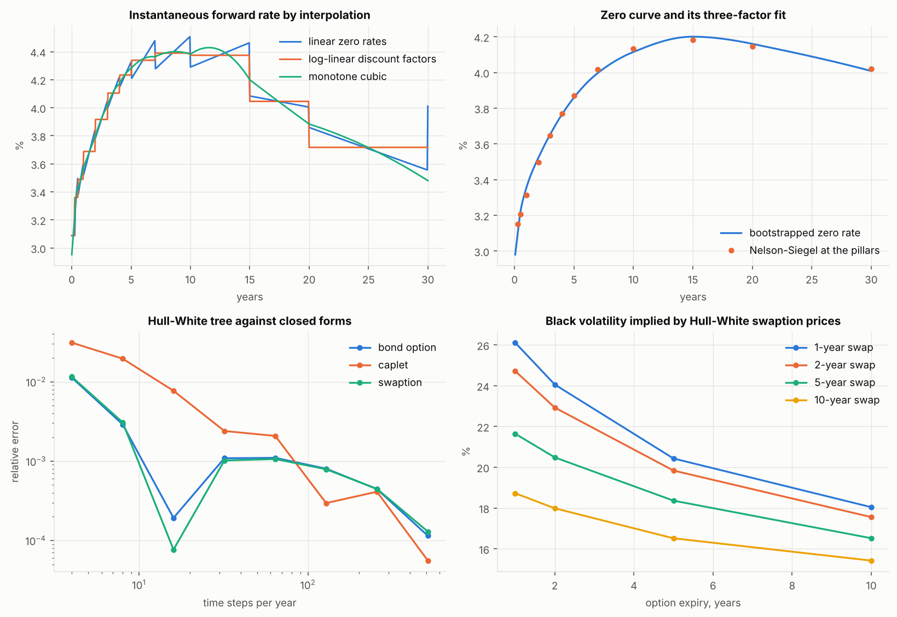

# CurveKit

A fixed-income library in C++17 with no dependencies: curve bootstrapping with three interpolations, bond and swap analytics, Black and Bachelier formulas, Vasicek and Cox-Ingersoll-Ross, and the Hull-White model with closed forms, a trinomial tree and calibration.

Every result in the report is one method checked by another: the bootstrap by repricing its inputs, duration by full repricing, the tree by closed forms, the closed forms by parity and by Monte Carlo, the calibration by recovering known parameters.

## What is inside

| Area | Files (`cpp/include/curvekit`, `cpp/src`) | Content |
|---|---|---|
| Numerics | `root`, `linsolve`, `interp`, `normal`, `rng` | Brent, golden section, Gaussian elimination, shape-preserving cubic |
| Curve | `curve`, `quotes`, `bootstrap`, `nelson_siegel` | discount curve with linear-zero, log-linear and monotone-cubic interpolation, iterative bootstrap from deposits, forward rate agreements and swaps, three-factor fit |
| Instruments | `schedule`, `bond`, `swap`, `black` | yield, duration, convexity, key-rate durations, par rates, caps and swaptions |
| Short rate | `shortrate`, `montecarlo` | Vasicek and Cox-Ingersoll-Ross bond prices, Vasicek bond options, simulation |
| Hull-White | `hullwhite`, `hwtree`, `calibration` | bond options, caplets, swaptions by Jamshidian's decomposition, trinomial tree fitted to the curve, Bermudan swaptions, calibration to swaption volatilities |

255 checks in `cpp/tests` run without any framework. Python (`src/curvekit`) drives the binary and writes the report.

## Results

Quotes: two deposits, one forward rate agreement and nine swaps out to 30 years (`configs/quotes.txt`). Full tables in `reports/report.md`.

| Test | Result |
|---|---|
| Bootstrap reprices its 12 quotes | error 3e-16 under all three interpolations; 2 sweeps for the local ones, 6 for the cubic |
| Largest change of the forward rate over 0.05 years | 45 bp linear zero, 33 bp log-linear, 8 bp monotone cubic |
| Key-rate durations of a 10-year bond | sum 8.3136, equal to the effective duration |
| Price after a 100 bp yield move | duration alone is off by 0.40 per 100 of face, with convexity by 0.014 |
| Nelson-Siegel fit of the zero curve | 2.7 bp root mean square, 6.3 bp at worst |
| Hull-White tree reproduces the curve | 3e-15 relative, at every step count |
| Tree against closed-form swaption, bond option, caplet | within 0.013% at 512 steps per year, 0.25% from 32 |
| Payer minus receiver swaption equals the forward swap | to rounding error, in closed form and on the tree |
| Bermudan against European payer swaption (2 years into 5) | 1.36 times |
| Calibration to 16 model-generated volatilities | recovers a = 0.050000, sigma = 0.0100000 |
| Same with the volatilities perturbed by 2% | a = 0.0523, sigma = 0.01009 |
| Vasicek bond price against simulation | within 1.2 standard errors up to 10 years |



## Three details that matter

1. **The bootstrap is a fixed-point iteration, not a single sweep.** With a cubic, moving one pillar changes the curve under the earlier ones, so a sequential bootstrap no longer reprices its inputs. Solving each pillar in turn and repeating until nothing moves costs a few sweeps and works for any interpolation.
2. **Interpolating log discount factors with a monotone cubic** keeps discount factors decreasing whenever the pillars are, so forward rates cannot turn negative between pillars, and they are continuous. The two simpler schemes make the forward curve jump at every pillar.
3. **The tree is fitted by forward induction on state prices**, which makes its discount factors exact for any step size. Its option prices then converge to the closed forms, but not monotonically: the error changes sign as the strike moves relative to the nodes.

## Reading the numbers

- The quotes are illustrative numbers, not market data. Nothing here is a statement about any real curve.
- Single curve: the same curve projects floating rates and discounts. There are no day-count conventions, calendars or settlement lags, all times are year fractions.
- The calibration test recovers parameters from volatilities that the same model produced. It shows that the optimiser and the pricing are consistent, not that Hull-White fits a market.
- The tree converges slowly in relative terms for options far out of the money (3% error at 32 steps per year for a put 10% out of the money). No smoothing of the payoff is applied.
- The Cox-Ingersoll-Ross simulation is an Euler scheme with truncation at zero. It sits about 5 standard errors below the closed form at 50 steps per year, a bias of at most 1.3 basis points of the price that shrinks as the step is refined. The check allows for it explicitly.
- The cubic forward curve is continuous but still moves 8 bp within 0.05 years near the short pillars, where the quotes themselves bend sharply.
- Black volatilities implied by Hull-White prices fall with expiry and tenor, from 26% to 15% here. The model has no smile to speak of, which is one of its known limits.
- Bonds are priced on a coupon date with the next coupon paid in full. Accrued interest between dates is not handled.

## Run it

```
pip install -e ".[dev]"
make build      # two binaries in cpp/build: curvekit and curvekit_tests
make test       # C++ checks, then pytest
make run        # writes reports/
```

```
python scripts/curve.py configs/quotes.txt monotone_cubic
python scripts/swaption.py 5 10 0.03 0.008
cpp/build/curvekit bond configs/quotes.txt maturity=7 coupon=0.035
```

In C++:

```cpp
#include "curvekit/bootstrap.hpp"
#include "curvekit/hullwhite.hpp"
#include "curvekit/hwtree.hpp"
#include "curvekit/quotes.hpp"

ck::Curve curve = ck::bootstrap(ck::read_quotes("configs/quotes.txt"), ck::Interpolation::MonotoneCubic).curve;
double european = ck::HullWhite(curve, 0.05, 0.01).swaption(2.0, 5.0, 2, 0.04, true);
double bermudan = ck::HullWhiteTree(curve, 0.05, 0.01, 7.0, 64).swaption(2.0, 5.0, 2, 0.04, true, true);
```

## Layout

```
cpp/include/curvekit/   headers, one per subject
cpp/src/                implementations and the command line program
cpp/tests/              255 checks with a small harness
src/curvekit/           Python driver, report and figure
configs/                quotes and experiment set-up
docs/                   methods and formulas
reports/                report, validation table, metrics, figure
```

## Author

Amir Masominia. PhD in physics (Université Paris-Saclay); postdoctoral researcher working on machine-learning surrogate models, numerical simulation and automated measurement pipelines.

MIT licence.
